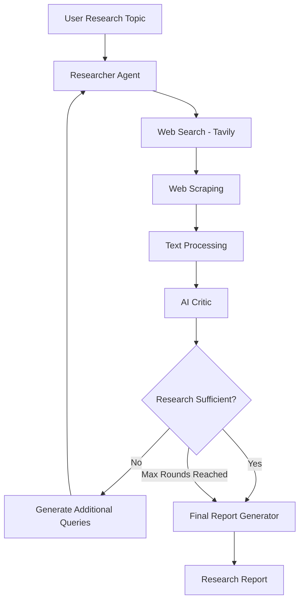

# Autonomous Research Agent

An AI-powered research assistant that autonomously searches the web, collects information, evaluates research quality, and generates structured research reports.

Built with **Python, LangGraph, RAG, Groq, Tavily, and FAISS**.

## Overview

The Autonomous Research Agent is a terminal-based AI system designed to automate the research process.

Instead of simply generating an answer from an LLM, the agent follows an iterative research workflow:

1. Takes a research topic from the user.
2. Searches the web for relevant information.
3. Scrapes and collects content from web pages.
4. Evaluates the collected research using an AI Critic.
5. Identifies missing information and generates additional search queries.
6. Repeats the research process until the quality is sufficient or the maximum number of rounds is reached.
7. Generates a structured final research report.

## Architecture



## Key Features

- **Autonomous Web Research:** Searches the web and collects relevant information.
- **Web Scraping:** Extracts readable content from web pages.
- **Text Chunking:** Splits collected documents into smaller chunks.
- **Semantic Search:** Uses Sentence Transformers to generate embeddings.
- **Vector Database:** Stores and retrieves research chunks using FAISS.
- **Retrieval-Augmented Generation (RAG):** Retrieves relevant context for question answering.
- **AI Critic:** Evaluates research quality and identifies missing information.
- **Iterative Research:** Uses critic feedback to guide additional research rounds.
- **LangGraph Workflow:** Manages nodes, conditional routing, and research loops.
- **Report Generation:** Produces structured research reports with source URLs.

## Tech Stack

| Technology | Purpose |
|---|---|
| Python | Core programming language |
| LangGraph | Agent workflow orchestration |
| Groq | LLM inference |
| Ollama | Local LLM support |
| Tavily | Web search |
| BeautifulSoup | Web scraping |
| Sentence Transformers | Text embeddings |
| FAISS | Vector similarity search |
| LangChain Text Splitters | Document chunking |

## Project Structure

```text
Autonomous-Research-Agent/
│
├── src/
│   └── research_agent/
│       ├── agent_graph.py
│       ├── critic.py
│       ├── research.py
│       ├── search.py
│       ├── scraper.py
│       ├── chunking.py
│       ├── embeddings.py
│       ├── vector_store.py
│       ├── storage.py
│       ├── rag.py
│       ├── llm.py
│       ├── prompts.py
│       ├── config.py
│       └── run_agent.py
│
├── data/
│   └── vector_store/
│
├── reports/
├── logs/
├── tests/
│
├── .env.example
├── .gitignore
├── requirements.txt
├── pyproject.toml
└── README.md
```

## Installation and Setup

### 1. Clone the repository

```bash
git clone https://github.com/samyamoy1/Autonomous-Research-Agent.git
cd Autonomous-Research-Agent
```

### 2. Create a virtual environment

```bash
python -m venv venv
```

Activate it on Windows PowerShell:

```powershell
.\venv\Scripts\Activate.ps1
```

### 3. Install dependencies

```bash
python -m pip install -r requirements.txt
```

### 4. Install the project

```bash
python -m pip install -e .
```

### 5. Configure environment variables

Create a `.env` file in the project root using `.env.example` as a template.

```env
GROQ_API_KEY=your_groq_api_key
TAVILY_API_KEY=your_tavily_api_key
LLM_PROVIDER=groq
```

You need API keys for your chosen Groq LLM provider and Tavily search service. Check their current free-tier limits.

### 6. Run the agent

```bash
python -m research_agent.run_agent
```

Enter your research topic when prompted.

## Example

**Input:**

```text
Why do LLMs hallucinate and what are the ways to reduce it?
```

The agent searches for relevant information, evaluates its findings, performs additional research when needed, and generates a final research report.

## LLM Configuration

The project supports multiple LLM providers:

- **Groq:** Cloud-based inference.
- **Ollama:** Local inference using models such as Qwen 2.5 1.5B.
- **Gemini:** Alternative cloud LLM provider.

Configure the provider using the `LLM_PROVIDER` variable in your `.env` file.

Provider availability, model access, and free-tier limits may vary.

## Learning Objectives

This project was developed to gain practical experience with:

- Large Language Models (LLMs)
- Retrieval-Augmented Generation (RAG)
- Semantic Search and Embeddings
- Vector Databases
- AI Agents and Agentic Workflows
- LangGraph State Management
- Conditional Edges and Cyclic Graphs
- AI-based Critique and Evaluation
- Autonomous Research Pipelines

## Limitations

- Web scraping depends on website accessibility and may fail on pages that block automated requests.
- Research quality depends on the relevance and reliability of retrieved sources.
- LLM outputs may still contain inaccurate information.
- API providers impose usage and rate limits.
- The AI Critic may not always accurately judge research completeness.

**Generated reports should be independently verified before being used as authoritative research.**

## Future Scope

Potential improvements include better source-quality ranking, more robust evaluation, and improved citation verification.

## Author

**Samyamoy Das**

B.Tech — Computer Science and Engineering (Artificial Intelligence)

GitHub: [@samyamoy1](https://github.com/samyamoy1)

---

If you find this project interesting, consider giving it a ⭐ on GitHub!
