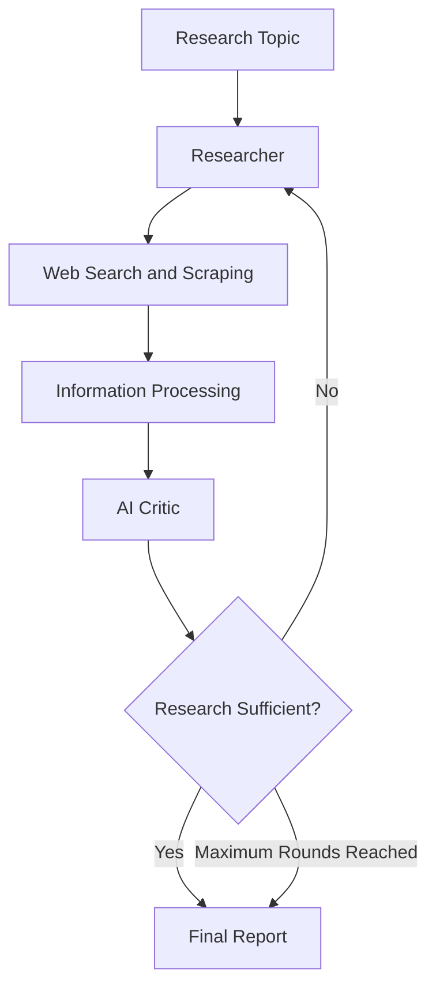

# Autonomous Research Agent

An AI-powered research assistant that automates web research, evaluates collected information, and generates structured research reports using LLMs and LangGraph.

## Overview

This project implements an autonomous research workflow where an AI agent searches the web, extracts relevant information, and evaluates the quality of its findings.

An AI Critic identifies missing information and provides feedback, allowing the researcher to perform additional research before generating the final report.

## Architecture



## Key Features

- Automated web search and content extraction.
- Document chunking and semantic embeddings.
- FAISS-based vector storage and retrieval.
- Retrieval-Augmented Generation (RAG).
- AI-powered research evaluation and feedback.
- Iterative research using LangGraph workflows.
- Structured report generation with source references.

## Tech Stack

- **Language:** Python
- **LLM Providers:** Groq, Ollama, Gemini
- **Agent Framework:** LangGraph
- **Web Search:** Tavily
- **Web Scraping:** BeautifulSoup, Requests
- **Embeddings:** Sentence Transformers
- **Vector Database:** FAISS
- **Text Processing:** LangChain Text Splitters

## Project Structure

```text
Autonomous-Research-Agent/
├── src/
│   └── research_agent/
│       ├── agent_graph.py
│       ├── critic.py
│       ├── research.py
│       ├── search.py
│       ├── scraper.py
│       ├── chunking.py
│       ├── embeddings.py
│       ├── vector_store.py
│       ├── storage.py
│       ├── rag.py
│       ├── llm.py
│       └── run_agent.py
├── data/
├── tests/
├── reports/
├── logs/
├── requirements.txt
├── pyproject.toml
└── README.md
```

## Installation

**1. Clone the repository**

```bash
git clone https://github.com/samyamoy1/Autonomous-Research-Agent.git
cd Autonomous-Research-Agent
```

**2. Create and activate a virtual environment**

```bash
python -m venv venv
.\venv\Scripts\Activate.ps1
```

**3. Install dependencies**

```bash
python -m pip install -r requirements.txt
python -m pip install -e .
```

**4. Configure environment variables**

Create a `.env` file using `.env.example` and provide the required API keys.

```env
GROQ_API_KEY=your_groq_api_key
TAVILY_API_KEY=your_tavily_api_key
LLM_PROVIDER=groq
```

**5. Run the agent**

```bash
python -m research_agent.run_agent
```

Enter a research topic when prompted.

## Technologies and Concepts

This project explores practical implementations of:

- Large Language Models (LLMs)
- Retrieval-Augmented Generation (RAG)
- Semantic Search and Vector Databases
- AI Agents and Agentic Workflows
- LangGraph State Management
- Conditional Routing and Cyclic Graphs
- AI-based Critique and Evaluation

## Limitations

- Research quality depends on the relevance and reliability of collected sources.
- Some websites may block automated scraping.
- LLM-generated content may contain inaccuracies and should be independently verified.
- API usage is subject to provider rate limits.

## Author

**Samyamoy Das**

B.Tech — Computer Science and Engineering (AI)

[GitHub Profile](https://github.com/samyamoy1)

